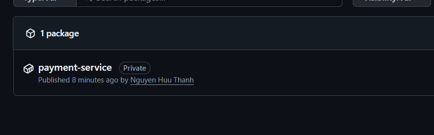
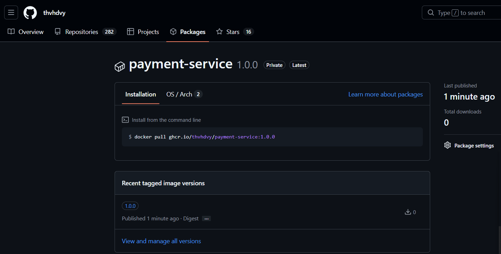

# Build và push image payment-service lên GHCR

## Các lệnh đã dùng

```bash
# Đăng nhập GHCR bằng PAT (classic, scope: write:packages, read:packages, repo)
read -s GHCR_TOKEN
echo $GHCR_TOKEN | docker login ghcr.io -u thvhdvy --password-stdin

# Build image và gắn tag đúng namespace
docker build -t ghcr.io/thvhdvy/payment-service:1.0.0 .

# Đẩy image lên registry
docker push ghcr.io/thvhdvy/payment-service:1.0.0
```

## Lỗi gặp phải

`error from registry: denied` khi push (các layer đã `Pushed` nhưng bước ghi manifest bị từ chối).
Nguyên nhân: PAT cũ không đủ quyền với package đã tồn tại. Tạo PAT classic mới có `write:packages`, `read:packages`, `repo`, đăng nhập lại rồi push thì thành công.

## Kết quả

Package: https://github.com/users/thvhdvy/packages/container/package/payment-service

Danh sách Packages:



Package `payment-service` với tag `1.0.0`:


